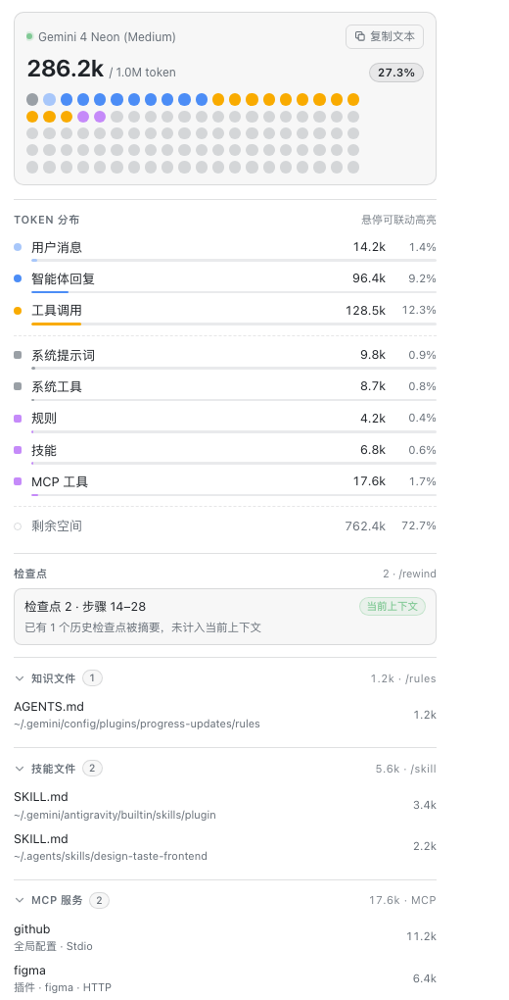
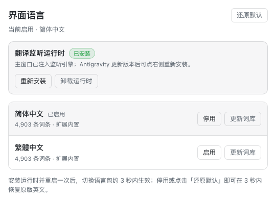

<div align="center">

# Antigravity Plugins

**用于独立版 Google Antigravity App 的实用插件合集**

[](https://antigravity.google)
[](#插件列表)
[](#快速安装推荐只装插件市场按需挑选)
[](https://github.com/Tangchen2016/antigravity-plugins/commits/main)
[](https://github.com/Tangchen2016/antigravity-plugins/stargazers)

[快速安装](#快速安装推荐只装插件市场按需挑选) · [插件列表](#插件列表) · [插件市场](#插件市场) · [更新与卸载](#更新与卸载) · [目录结构](#目录结构) · [常见问题](#常见问题)

</div>

---

## 快速安装（推荐：只装「插件市场」，按需挑选）

默认只需安装 **插件市场（`plugin-market`）** 这一个入口扩展，装完即可在 Antigravity 右侧边栏可视化浏览、按需安装、更新和停用其他插件，无需一次全装。

### 方式一：通过 Agent 安装（推荐）

直接复制下面这句话发给 Antigravity，让 Agent 自动完成安装：

```text
帮我从 https://github.com/Tangchen2016/antigravity-plugins 运行 install.sh 安装插件市场
```

### 方式二：命令行一键安装

在终端执行（点击代码块右上角可直接复制）：

```bash
curl -fsSL https://raw.githubusercontent.com/Tangchen2016/antigravity-plugins/main/install.sh | bash
```

安装完成后，在会话右侧打开 **概览 → 扩展 → 插件市场** 即可按需安装下方任意插件（首次安装扩展如未出现，重启一次 Antigravity 即可）。

> 若希望一次性命令行安装仓库内全部插件，可执行：
> ```bash
> curl -fsSL https://raw.githubusercontent.com/Tangchen2016/antigravity-plugins/main/install.sh | bash -s -- --all
> ```

---

## 插件列表

| 插件 | 类型 | 核心功能 | 安装 |
| :--- | :--- | :--- | :--- |
| 🧩 **[插件市场](#插件市场)**<br>`plugin-market` | 侧边栏扩展 | 浏览远端插件市场、自动对比版本并高亮更新提醒，一键管理本机插件的安装、更新、启用、停用与卸载，支持自定义 GitHub 源 | [复制命令](#安装插件市场) |
| 📊 **[上下文用量](#上下文用量)**<br>`desktop-context` | 侧边栏扩展 | 中文展示模型名称、上下文点阵图、分类 Token 占用与水位预警、可折叠上下文文件与已启用 MCP 服务，支持双向悬停联动和一键复制 CLI 报告 | [复制命令](#安装上下文用量) |
| 🌐 **[语言包管理](#语言包管理)**<br>`language-packs` | 侧边栏扩展 | 自包含中文汉化（4,908 条词库）与监听运行时，支持在面板内唤起终端一键安装/卸载及 3 秒热切换简/繁/英文 | [复制命令](#安装语言包管理) |
| 💬 **[进度播报与节奏控制](#进度播报与节奏控制)**<br>`progress-updates` | 规则 + 侧边栏 | 改善模型闷头静默执行；自带侧边栏设置面板，支持一键切换聊天极简 TodoList、右侧 Artifact 原地看板与经典里程碑模式 | [复制命令](#安装进度播报与节奏控制) |

---

## 插件市场

`plugins/plugin-market/` 是本仓库的核心入口扩展，提供侧边栏图形化插件市场与本机插件管理能力，装好它之后即可按需挑选和更新其他插件，无需反复敲命令。

<p>
  
</p>

### 核心特性
- **已安装管理**：基于官方 `agy plugin` CLI 展示本机插件状态，支持搜索过滤及一键 **启用 / 停用 / 更新 / 卸载**。
- **版本比对与更新提醒**：拉取仓库根目录的 `marketplace.json` 自动比对本机版本，有更新时在顶部横幅、Tab 角标和插件卡片同步高亮提醒，支持单个或 **全部更新**。
- **自定义源扩展**：支持在面板底部添加任意包含 `marketplace.json` 的 GitHub 仓库作为插件源。

### 安装插件市场

```bash
curl -fsSL https://raw.githubusercontent.com/Tangchen2016/antigravity-plugins/main/install.sh | bash
```

安装后在会话右侧打开 **概览 → 扩展 → 插件市场** 即可使用。

---

## 上下文用量

`plugins/desktop-context/` 提供中文上下文用量面板，帮助你实时掌握当前会话的 Token 分布、窗口水位与已启用的 MCP 服务。

<p>
  
</p>

### 核心特性
- **概览卡片与水位预警**：显示模型名称、已用 / 总窗口 Token 和 100 格点阵图；占比 `≥ 70%` 琥珀预警、`≥ 85%` 红色告警。
- **分类分布与双向联动**：展示用户消息、智能体回复、工具调用、系统提示词、技能、MCP 工具等分类占用微条；悬停圆点或分类行可双向高亮联动。
- **上下文文件与 MCP 服务**：可折叠查看知识文件、产物文件、技能文件、系统文件、检查点以及当前启用的 **MCP 服务**（合并全局/工作区/插件配置与会话内 MCP token 占用），并支持一键复制 CLI 格式文本报告。

### 安装上下文用量

可在 **插件市场** 直接点击安装，或命令行安装（需 `PATH` 中包含 Python 3.10+）：

```bash
curl -fsSL https://raw.githubusercontent.com/Tangchen2016/antigravity-plugins/main/install.sh | bash -s -- desktop-context
```

在会话右侧打开 **概览 → 扩展 → 上下文用量**。详细说明与测试命令见 [插件说明](plugins/desktop-context/README.md)。

---

## 语言包管理

`plugins/language-packs/` 是自包含的 Antigravity 中文汉化与语言包管理扩展：**运行时只负责向主窗口注入监听引擎，不自带重复词库；所有简/繁体翻译文案（4,908 条）统一由插件维护**，支持在侧边栏内一键安装/卸载运行时并实时切换中/英文。

<p>
  
</p>

### 安装语言包管理

可在 **插件市场** 直接点击安装，或命令行安装：

```bash
curl -fsSL https://raw.githubusercontent.com/Tangchen2016/antigravity-plugins/main/install.sh | bash -s -- language-packs
```

安装后在会话右侧打开 **概览 → 扩展 → 语言包管理**，点击面板顶部的 **「安装运行时」** 会自动打开 macOS 系统「终端」执行安装脚本，输入开机密码完成后重启一次 Antigravity 即可开始实时切换。

> 也可以在终端手动执行安装或卸载脚本：
> ```bash
> bash ~/.gemini/config/plugins/language-packs/runtime/install-runtime.sh
> bash ~/.gemini/config/plugins/language-packs/runtime/uninstall-runtime.sh
> ```

### 使用说明
- **中/英实时热切换**：启用简体中文或繁體中文约 3 秒生效；点击 **停用** 或顶部 **还原默认** 即可在约 3 秒内恢复原版英文（无需卸载运行时）。
- **自定义词库与还原**：点击 **更新词库** 导入自定义 JSON（格式为 `{"英文原文":"译文"}`），点击 **还原内置** 可撤销本地导入词库。
- **面板内管理运行时**：Antigravity 更新版本后，可直接在面板内点 **重新安装**，或随时点 **卸载运行时** 还原官方应用包。

---

## 进度播报与节奏控制

`plugins/progress-updates/` 用来解决模型在多步骤任务中容易长时间闷头执行、黑盒静默的问题，并自带侧边栏设置面板可随时切换播报风格。

<p>
  
</p>

### 核心特性
- **三种模式随时切换**：在右侧 **概览 → 扩展 → 进度播报设置** 可一键切换，下一轮对话即生效：
  - **方案 A · 聊天极简 TodoList（默认）**：动手前只发 1 次编号清单，中途仅发 1 行 `> 进展（2/4）｜...` 不刷屏；
  - **方案 B · 右侧 Artifact 原地看板**：在右侧 `task.md` 原地勾选更新，聊天流保持单行进度；
  - **经典模式**：不列清单，仅在关键节点自然简短播报。
- **强约束与视觉分层**：过程播报统一用 `>` 引用块弱化显示，与最终结构化正文回复明显区分。
- **只在关键节点暂停**：常规小决策自主推进，仅在方向分叉且返工成本高、高风险/不可逆操作、或遇到预期外阻塞时停下来确认。

### 安装进度播报与节奏控制

可在 **插件市场** 直接点击安装，或命令行安装：

```bash
curl -fsSL https://raw.githubusercontent.com/Tangchen2016/antigravity-plugins/main/install.sh | bash -s -- progress-updates
```

规则部分无需重启、下一轮对话即自动生效；可在 **概览 → 扩展 → 进度播报设置** 中切换模式。

---

## 更新与卸载

- **图形化更新 / 卸载（推荐）**：打开右侧 **概览 → 扩展 → 插件市场**，可一键更新单个或全部插件，以及启用、停用、卸载。
- **命令行更新全部插件**：
  ```bash
  curl -fsSL https://raw.githubusercontent.com/Tangchen2016/antigravity-plugins/main/install.sh | bash -s -- --all
  ```
- **命令行卸载指定插件**：
  ```bash
  rm -rf ~/.gemini/config/plugins/<插件名>
  ```

---

## 目录结构

```text
antigravity-plugins/
├── install.sh                    # 一键安装脚本（默认仅装 plugin-market）
├── marketplace.json              # 插件市场索引清单
├── README.md                     # 合集说明文档
├── docs/images/                  # 插件效果预览图
└── plugins/
    ├── plugin-market/            # 插件市场与本机插件管理扩展
    ├── desktop-context/          # 上下文用量侧边栏扩展
    ├── language-packs/           # 语言包管理与汉化运行时扩展
    └── progress-updates/         # 进度播报与节奏控制（规则 + 设置面板）
```

---

## 常见问题

<details>
<summary><b>更新侧边栏扩展后，面板里看到的还是旧界面怎么办？</b></summary>

侧边栏标签页打开后只会轮询数据接口，不会自动重载 HTML 页面；侧边栏后端进程也会保活复用。关闭旧标签页后重开，或完全退出重启一次 Antigravity 即可加载最新版本。

</details>

<details>
<summary><b>安装或修改规则插件（如 <code>progress-updates</code>）需要重启或新开会话吗？</b></summary>

不需要。Antigravity 会在每一轮请求时动态加载已启用的全局规则，安装或切换模式后在当前会话的下一轮回复就会立即生效。

</details>
