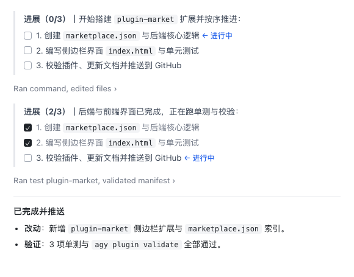
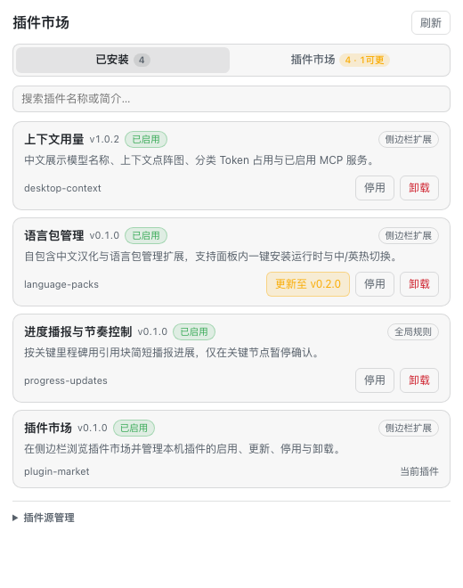

<div align="center">

# Antigravity Plugins

**用于独立版 Google Antigravity App 的实用插件合集**

[](https://antigravity.google)
[](#插件列表)
[](#快速安装)
[](https://github.com/Tangchen2016/antigravity-plugins/commits/main)
[](https://github.com/Tangchen2016/antigravity-plugins/stargazers)

[快速安装](#快速安装) · [插件列表](#插件列表) · [插件详情](#上下文用量) · [更新与卸载](#更新与卸载) · [目录结构](#目录结构) · [常见问题](#常见问题)

</div>

---

## 快速安装

### 方式一：通过 Agent 安装（推荐）

直接复制下面这句话发给 Antigravity，让 Agent 自动完成下载与安装：

```text
帮我从 https://github.com/Tangchen2016/antigravity-plugins 运行 install.sh 安装全部插件
```

> 如果只想安装单个插件，把「全部插件」换成插件名即可（如 `progress-updates`、`desktop-context`、`language-packs`）。

### 方式二：命令行一键安装

在终端执行（点击代码块右上角可直接复制）：

```bash
curl -fsSL https://raw.githubusercontent.com/Tangchen2016/antigravity-plugins/main/install.sh | bash
```

> 再次运行同一条命令即可更新到最新版本；若已克隆仓库到本地，也可直接执行 `./install.sh`、`./install.sh --list` 或 `./install.sh <插件名>`。

---

## 插件列表

| 插件 | 类型 | 核心功能 | 安装 |
| :--- | :--- | :--- | :--- |
| 📊 **[上下文用量](#上下文用量)**<br>`desktop-context` | 侧边栏扩展 | 中文展示模型名称、上下文点阵图、分类 Token 占用与水位预警、可折叠上下文文件列表，支持双向悬停联动和一键复制 CLI 文本报告 | [复制命令](#安装上下文用量) |
| 🌐 **[语言包管理](#语言包管理)**<br>`language-packs` | 侧边栏扩展 | 内置简/繁体词库，支持一键切换、导入 JSON 热更新词库（约 3 秒生效）与恢复基础词库 | [复制命令](#安装语言包管理) |
| 💬 **[进度播报与节奏控制](#进度播报与节奏控制)**<br>`progress-updates` | 全局规则 | 让 Agent 按关键里程碑用引用块弱化播报进展，常规步骤自主推进，仅在分叉/高风险/阻塞节点暂停确认 | [复制命令](#安装进度播报与节奏控制) |
| 🧩 **[插件市场](#插件市场)**<br>`plugin-market` | 侧边栏扩展 | 浏览远端插件市场、自动对比版本并管理本机插件，支持一键安装、更新、启用、停用、卸载及自定义 GitHub 源 | [复制命令](#安装插件市场) |

---

## 上下文用量

`plugins/desktop-context/` 提供中文上下文用量面板，帮助你实时掌握当前会话的 Token 分布、窗口水位与已启用的 MCP 服务。

<p>
  
</p>

### 核心特性
- **概览卡片与水位预警**：显示模型名称、已用 / 总窗口 Token 和 100 格点阵图；占比 `≥ 70%` 琥珀预警、`≥ 85%` 红色告警。
- **分类分布与双向联动**：展示用户消息、智能体回复、工具调用、系统提示词、技能、MCP 工具等分类占用微条；悬停圆点或分类行可双向高亮联动。
- **上下文文件与 MCP 服务**：可折叠查看知识文件、产物文件、技能文件、系统文件、检查点以及当前启用的 **MCP 服务**（合并全局/工作区/插件配置与会话内 MCP token 占用），并支持一键复制 CLI 格式文本报告。

### 安装上下文用量

Antigravity App 需要能在 `PATH` 上找到 Python 3.10 或更新版本：

```bash
curl -fsSL https://raw.githubusercontent.com/Tangchen2016/antigravity-plugins/main/install.sh | bash -s -- desktop-context
```

打开 **个性化定制 → 已安装** 查看 **上下文用量**，在会话右侧打开 **概览 → 扩展 → 上下文用量**。详细说明与测试命令见 [插件说明](plugins/desktop-context/README.md)。

---

## 语言包管理

`plugins/language-packs/` 是自包含的 Antigravity 中文汉化与语言包管理扩展：**运行时只负责向主窗口注入监听引擎，不自带重复词库；所有简/繁体翻译文案（4,903 条）统一由插件维护**，支持在侧边栏内一键安装/卸载运行时并实时切换中/英文。

<p>
  
</p>

### 安装语言包管理

```bash
curl -fsSL https://raw.githubusercontent.com/Tangchen2016/antigravity-plugins/main/install.sh | bash -s -- language-packs
```

安装后在会话右侧打开 **概览 → 扩展 → 语言包管理**，直接点击面板顶部的 **「安装运行时」**（macOS 会弹出系统管理员授权框），完成后重启一次 Antigravity 即可开始实时切换。

> 也可以在终端手动执行安装或卸载脚本：
> ```bash
> bash ~/.gemini/config/plugins/language-packs/runtime/install-runtime.sh
> bash ~/.gemini/config/plugins/language-packs/runtime/uninstall-runtime.sh
> ```

### 使用说明
- **中/英实时热切换**：启用简体中文或繁體中文约 3 秒生效；点击 **停用** 或顶部 **还原默认** 即可在约 3 秒内恢复原版英文（无需卸载运行时）。
- **自定义词库与还原**：点击 **更新词库** 导入自定义 JSON（格式为 `{"英文原文":"译文"}`），点击 **还原内置** 可撤销本地导入词库。
- **面板内管理运行时**：Antigravity 更新版本后，可直接在面板内点 **重新安装**，或随时点 **卸载运行时** 还原官方应用包。

---

## 进度播报与节奏控制

`plugins/progress-updates/` 是一个全局规则插件，用来解决模型在多步骤任务中容易长时间闷头执行、黑盒静默的问题。

<p>
  
</p>

### 核心特性
- **多任务 TodoList 进度追踪**：遇到多步骤任务（≥ 3 项）时，动手前先在引用块内列出 Todo 清单与总进度（如 `0/4`），每到关键节点自动勾选 `[x]` 并标注 `← 进行中`，一眼看清总任务数与剩余进度。
- **消息体视觉分层**：过程播报统一用 `> **进展（2/4）｜**...` 引用块弱化显示，与最终结构化正文回复明显区分。
- **只在关键节点暂停**：常规小决策自主推进，仅在方向分叉且返工成本高、高风险/不可逆操作、或遇到预期外阻塞时停下来确认。

### 安装进度播报与节奏控制

```bash
curl -fsSL https://raw.githubusercontent.com/Tangchen2016/antigravity-plugins/main/install.sh | bash -s -- progress-updates
```

无需重启或新开会话，下一轮对话即自动生效；可在 **个性化定制 → 已安装** 中随时启用或停用。

---

## 插件市场

`plugins/plugin-market/` 提供侧边栏图形化插件管理与市场浏览能力，让你无需敲命令就能管理本机所有插件。

<p>
  
</p>

### 核心特性
- **已安装管理**：基于官方 `agy plugin` CLI 展示本机插件状态，支持搜索过滤及一键 **启用 / 停用 / 更新 / 卸载**（内置自身防误删保护）。
- **市场与版本比对**：拉取仓库根目录的 `marketplace.json` 自动比对本机版本，直观标出 **未安装 / 已安装 / 有新版本**，一键下载安装或更新。
- **自定义源扩展**：支持在面板底部添加任意包含 `marketplace.json` 的 GitHub 仓库作为插件源。

### 安装插件市场

```bash
curl -fsSL https://raw.githubusercontent.com/Tangchen2016/antigravity-plugins/main/install.sh | bash -s -- plugin-market
```

安装后在会话右侧打开 **概览 → 扩展 → 插件市场** 即可使用。

---

## 更新与卸载

- **更新全部插件**：重新运行一键安装命令即可覆盖更新到最新版本：
  ```bash
  curl -fsSL https://raw.githubusercontent.com/Tangchen2016/antigravity-plugins/main/install.sh | bash
  ```
- **卸载指定插件**：在 Antigravity **个性化定制 → 已安装** 中直接关闭/卸载，或删除对应目录：
  ```bash
  rm -rf ~/.gemini/config/plugins/<插件名>
  ```

---

## 目录结构

```text
antigravity-plugins/
├── install.sh                    # 一键安装 / 更新脚本
├── marketplace.json              # 插件市场索引清单
├── README.md                     # 合集说明文档
├── docs/images/                  # 插件效果预览图
└── plugins/
    ├── desktop-context/          # 上下文用量侧边栏扩展
    ├── language-packs/           # 语言包管理侧边栏扩展
    ├── progress-updates/         # 进度播报与节奏控制全局规则
    └── plugin-market/            # 插件市场与本机插件管理扩展
```

---

## 常见问题

<details>
<summary><b>更新侧边栏扩展后，面板里看到的还是旧界面怎么办？</b></summary>

侧边栏标签页打开后只会轮询数据接口，不会自动重载 HTML 页面。关闭右侧旧的扩展标签页后重新打开（或在 **个性化定制 → 已安装** 中将该插件关闭再重新启用）即可加载最新版本。

</details>

<details>
<summary><b>安装或修改规则插件（如 <code>progress-updates</code>）需要重启或新开会话吗？</b></summary>

不需要。Antigravity 会在每一轮请求时动态加载已启用的全局规则，安装或修改后在当前会话的下一轮回复就会立即生效。

</details>
