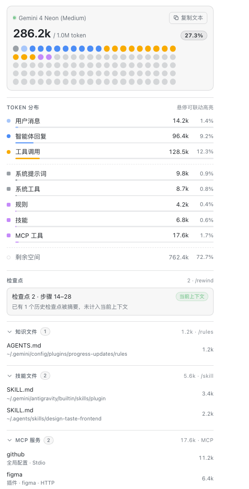

# 上下文用量 (`desktop-context`)

用于 **Google Antigravity** 桌面端的中文上下文用量侧边栏面板，基于 Antigravity CLI `/context` 同源数据解析，实时呈现当前会话的上下文占用、压缩水位预警、会话累计与按模型拆分的 Token/缓存消耗，以及技能与 MCP 服务的可搜索启停管理。



## 核心特性

- **精确同源统计**：直接只读解析当前会话数据库（`~/.gemini/antigravity/conversations/<id>.db`）并实时拉取模型目录，分类、总量、检查点与上下文文件与 `agy /context` 保持一致。
- **点阵图与压缩阈值预警**：100 格点阵图直观展示系统、用户消息、智能体回复、工具调用、自定义配置与剩余空间占比；上下文水位 `≥ 70%` 琥珀预警、`≥ 85%` 红色告警，支持悬停圆点与分类行双向高亮联动。
- **会话累计与按模型拆分**：统计整场会话的输入/输出 Token 与缓存命中消耗，并支持按模型维度拆分查看。
- **技能与 MCP 服务管理**：汇总展示全局、工作区与插件来源的技能与 MCP 服务，支持通过**可搜索弹窗**快速检索并一键启用 / 停用。
- **一键复制文本报告**：支持导出与 `agy /context` 一致的纯文本报告。

## 安装方式

需要本机 `PATH` 中包含 Python 3.10+。可在 **插件市场** 中直接点击安装，或命令行安装：

```bash
curl -fsSL https://raw.githubusercontent.com/Tangchen2016/antigravity-plugins/main/install.sh | bash -s -- desktop-context
```

安装完成后，在会话右侧打开 **概览 → 扩展 → 上下文用量** 即可使用（首次安装如未立即出现，重启一次 Antigravity 即可）。

## 目录结构

```text
plugins/desktop-context/
├── plugin.json                        # 插件清单
├── README.md                          # 插件说明
├── LICENSE                            # MIT 开源协议
├── assets/logo.svg                    # 插件图标
├── sidecars/context/
│   ├── sidecar.json                   # Sidecar 注册配置
│   ├── main.mjs                       # Sidecar 后端（报告缓存、模型目录、技能/MCP 管理）
│   ├── context_report.py              # 会话数据库解析器（可独立命令行运行）
│   └── index.html                     # 侧边栏界面
└── tests/
    └── test_context_report.py         # 解析器单元测试
```

## 命令行与测试

解析器支持脱离侧边栏单独运行：

```bash
# 解析最近活跃的桌面端会话
python3 plugins/desktop-context/sidecars/context/context_report.py

# 解析指定会话并输出 JSON
python3 plugins/desktop-context/sidecars/context/context_report.py --conversation-id <uuid> --workspace /path/to/workspace --json
```

运行单元测试（仅依赖 Python 标准库）：

```bash
python3 -m unittest discover plugins/desktop-context/tests
```

## 致谢与协议

本插件基于开源项目 [dimitr-io/antigravity-desktop-context](https://github.com/dimitr-io/antigravity-desktop-context) 进行中文化与功能增强，遵循 [MIT License](LICENSE)。
