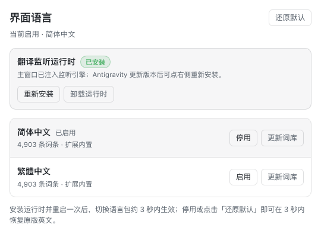

# 语言包管理 (`language-packs`)

用于 **Google Antigravity** 的自包含中文汉化与语言包管理扩展：内置简体中文 / 繁體中文词库（近 5,000 条映射）与监听运行时，支持在侧边栏一键安装/卸载运行时，并实现简/繁/原版英文约 3 秒热切换。



## 核心特性

- **自包含架构**：运行时仅负责向主窗口注入监听引擎，不额外冗余词库；所有简/繁体翻译文案统一由插件维护。
- **3 秒实时热切换**：启用简体中文或繁體中文约 3 秒生效；点击 **停用** 或顶部 **还原默认** 即可在约 3 秒内恢复原版英文，无需卸载运行时或重启应用。
- **面板内一键管理运行时**：点击顶部「安装运行时」会自动唤起 macOS 终端执行安装脚本；Antigravity 客户端升级后可点「重新安装」重新注入，也可随时点「卸载运行时」完整还原官方应用包。
- **自定义词库与一键还原**：支持导入本地 JSON 词库（格式为 `{"英文原文": "译文"}`），随时点击「还原内置」撤销自定义覆盖。

## 安装与使用

### 1. 安装插件

在 **插件市场** 中直接点击安装，或通过命令行安装：

```bash
curl -fsSL https://raw.githubusercontent.com/Tangchen2016/antigravity-plugins/main/install.sh | bash -s -- language-packs
```

### 2. 安装监听运行时

1. 打开会话右侧 **概览 → 扩展 → 语言包管理**。
2. 点击面板顶部的 **「安装运行时」**，在弹出的终端中输入开机密码完成安装。
3. 重启一次 Antigravity 后，即可在面板内实时切换简体中文 / 繁體中文 / 原版英文。

也可以在终端手动执行安装或卸载脚本：

```bash
bash ~/.gemini/config/plugins/language-packs/runtime/install-runtime.sh
bash ~/.gemini/config/plugins/language-packs/runtime/uninstall-runtime.sh
```

## 目录结构

```text
plugins/language-packs/
├── plugin.json                        # 插件清单
├── README.md                          # 插件说明
├── dictionaries/
│   ├── zh-CN.json                     # 简体中文词库
│   └── zh-TW.json                     # 繁體中文词库
├── runtime/
│   ├── install-runtime.sh             # 运行时安装脚本
│   ├── uninstall-runtime.sh           # 运行时卸载还原脚本
│   ├── localization_engine.js         # 渲染层实时翻译引擎
│   └── src/                           # app.asar 补丁与预加载注入脚本
├── sidecars/language-packs/
│   ├── sidecar.json                   # Sidecar 注册配置
│   ├── main.mjs                       # Sidecar 服务入口
│   ├── packs.mjs                      # 词库与运行时状态管理
│   └── index.html                     # 侧边栏界面
└── tests/
    └── packs.test.mjs                 # 单元测试
```

## 运行测试

```bash
node --test plugins/language-packs/tests/packs.test.mjs
```
