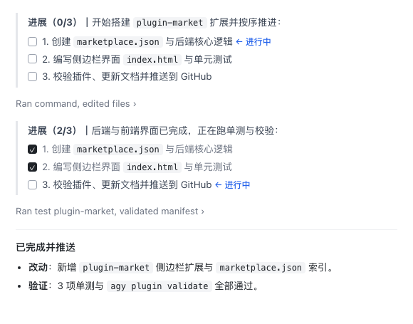

# 进度播报与节奏控制 (`progress-updates`)

用于 **Google Antigravity** 的全局沟通节奏规则与侧边栏设置面板，解决模型在多步骤任务中长时间闷头静默执行的问题，同时严格控制播报长度与频次以节省 Token。



## 核心特性

- **三种播报模式一键切换**：在右侧 **概览 → 扩展 → 进度播报设置** 中可随时切换，下一轮对话立即生效，无需重启：
  - **方案 A · 聊天极简 TodoList（默认推荐）**：多步骤任务动手前仅发 1 次编号清单，常规排查静默执行，仅在节点发 1 行（≤ 30 字）进度，克制省 Token。
  - **方案 B · 右侧 Artifact 原地看板**：在右侧 Artifacts 面板原地维护并勾选 `task.md`，聊天区保持单行简洁同步。
  - **经典模式**：不列清单，仅在关键里程碑节点做简短自然播报。
- **视觉分层**：过程进度统一使用 `>` 引用块弱化显示，与最终正文结论清晰区分。
- **自主推进、关键节点暂停**：常规小决策直接推进；仅在方向分叉且返工成本高、高风险/不可逆操作或遇到预期外阻塞时暂停确认。

## 安装与使用

在 **插件市场** 中直接点击安装，或通过命令行安装：

```bash
curl -fsSL https://raw.githubusercontent.com/Tangchen2016/antigravity-plugins/main/install.sh | bash -s -- progress-updates
```

- **规则生效**：全局规则位于 `rules/AGENTS.md`，安装或切换模式后在当前会话的**下一轮对话**立即生效，无需重启 Antigravity。
- **切换模式**：在会话右侧打开 **概览 → 扩展 → 进度播报设置** 选择对应模式即可自动写入规则文件。

## 目录结构

```text
plugins/progress-updates/
├── plugin.json                        # 插件清单
├── README.md                          # 插件说明
├── rules/
│   └── AGENTS.md                      # 当前生效的全局规则文件
└── sidecars/progress-updates/
    ├── sidecar.json                   # Sidecar 注册配置
    ├── main.mjs                       # 模式定义与规则读写接口
    └── index.html                     # 模式切换侧边栏界面
```
